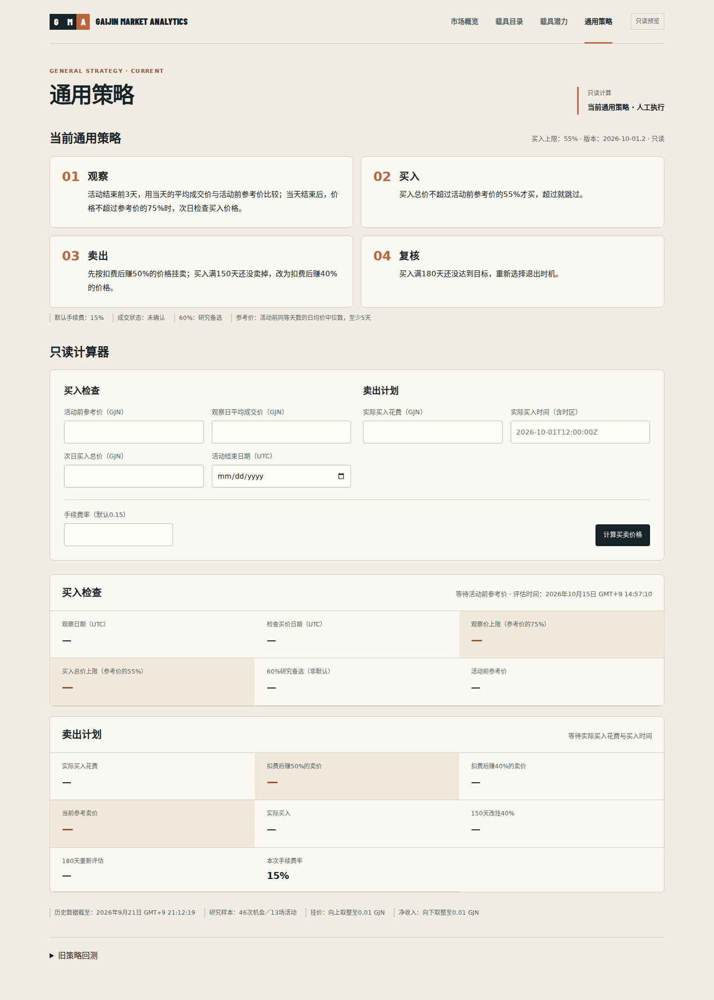

# Homepage and general strategy visual review — 2026-10-15

Implemented from `feat/general-rule-20261001` at `d9451cad64b2fc3aaf7b3058de4293f81a94bc96` on `feat/cloud-home-strategy-20261015`. The reference production implementation remains `7c44489280db072da9b7ac2cdebeed9d0180e7de`. **Not deployed.** No production deployment credentials or existing cloud release mechanism were available in this task.

## Changes

- Homepage: paper feature card, balanced verified vehicle image, prominent dated historical average, separate missing/current/stale order-book state, clearer search, responsive recent directory and direct links to potential and strategy.
- General strategy: four complete action rules in a two-column desktop / single-column phone layout; semantic buy/sell fieldsets; separate result cards; copper emphasis for observation and actual buy ceilings and preferred/current sell offers. Legacy disclosure is visually separated.
- CSS additions are scoped to homepage and current strategy components. Shared navigation, other pages, vehicle mappings/assets, dependencies and lockfile are unchanged.
- Strategy text, version 2026-10-01.2, all numeric parameters and server calculations are unchanged. GET input names and values, budget/as_of persistence, date/time semantics and explicit legacy=1 loading are retained. No API, database, Marketplace access or trading changes.

## Verification

Environment: Node v24.19.0, pnpm 11.7.0; installed with `npx --yes pnpm@11.7.0 install --frozen-lockfile`.

| Command | Result |
| --- | --- |
| `pnpm web:test` | 148 passed; zero failed |
| `pnpm web:lint` | Zero errors; one existing `@next/next/no-img-element` warning in `screen-recognition-workspace.tsx:539` |
| `pnpm --filter @gaijin-market-analytics/web typecheck` | Passed |
| `API_BASE_URL=https://bvvd-analysis.duckdns.org pnpm web:build` | Passed; production build and generated route types |
| `git diff --check` | Passed |

The commands above ran with the pinned pnpm through `npx --yes pnpm@11.7.0`. Python, database and API suites were not run for this frontend-only change.

Browser verification used the production build served locally against the public read-only API. Temporary Playwright and Chromium tooling was outside the repository; no browser or font package was added to the application. An existing Next.js standalone-mode advisory appears when using `next start` for the local review; the existing deployment configuration was not modified.

- Desktop 1440×1000, tablet 820×1180, phone 390×844, narrow phone 320×800: both pages rendered with no horizontal overflow. Chinese fonts installed only in the verification environment; no site font downloads added.
- Live catalog shows original verified vehicles, source links, historical date 2026-09-21 and missing order books. Prices remain historical rather than actionable current quotes.
- Real calculator GET submission preserved all nine values: budget, as_of, baseline, observation_price, quoted_cost, event_closes_on, entry_cost, bought_at, fee_rate. Test inputs 100 / 70 / 55 / actual cost 50 and fee 0.15 returned 75.00 and 55.00 GJN thresholds, 88.24 and 82.36 GJN sell offers from the real API. Input values are validation inputs, not production market observations.
- Keyboard search `M8` navigated to `/items?search=M8`; search button and calculator field focus rings were visible. No browser page errors occurred in the live-page checks.
- Local-only empty/error/delayed fixtures verified home empty, home and strategy error, and loading on both routes. Screenshots are visibly labelled as simulated verification states. Captured public API responses were replayed locally for this check; fixtures and response payloads are not committed.
- Recorded local API requests confirm no legacy ledger load on the default strategy route or merely opening the disclosure. Following the explicit `legacy=1` link requested the ledger. Error rendering for that legacy request was also checked.
- Found and fixed a phone fieldset legend/field overflow during browser review, then reran the viewport and interaction checks.

Raw assertions and request records: [browser-checks.json](browser-checks.json), [state-checks.json](state-checks.json).

## Screenshots

| View | Homepage | Strategy |
| --- | --- | --- |
| Desktop | [Home](home-desktop.png) | [Strategy](strategy-desktop.png) |
| Tablet | [Home](home-tablet.png) | [Strategy](strategy-tablet.png) |
| Phone | [Home](home-mobile.png) | [Strategy](strategy-mobile.png) |
| Narrow phone | [Home](home-narrow.png) | [Strategy](strategy-narrow.png) |
| Loading, simulated | [Home](home-loading-mobile.png) | [Strategy](strategy-loading-mobile.png) |
| Error, simulated | [Home](home-error-mobile.png) | [Strategy](strategy-error-mobile.png) |

[Calculated example](strategy-calculated-desktop.png) · [Keyboard focus](home-keyboard-focus.png) · [Empty catalog, simulated](home-empty-mobile.png)

